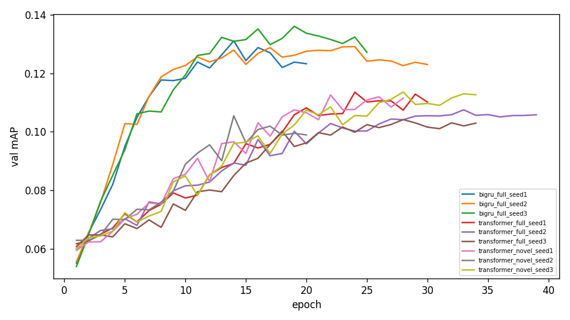
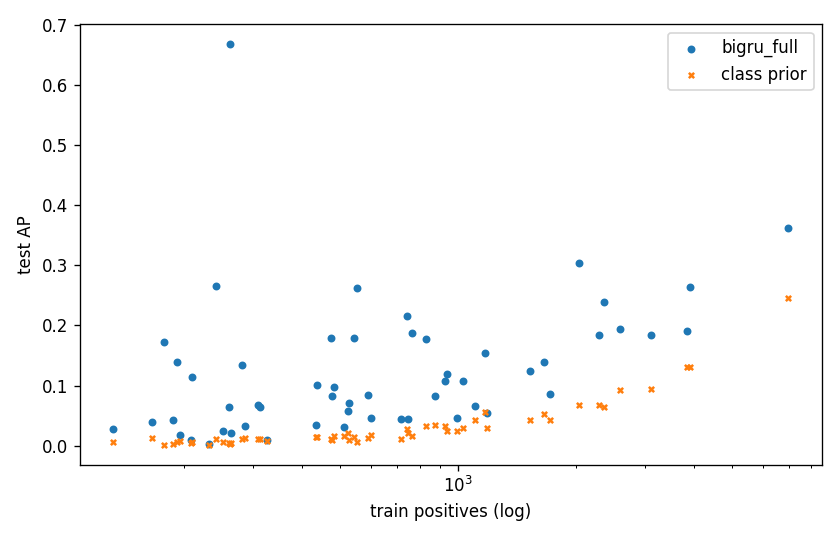

# Sign Spotting in Continuous ASL Video from Body and Hand Pose

Detects which of 55 American Sign Language (ASL) signs appear in a continuous signing clip,
using only 2D body and hand keypoints. Built on the How2Sign dataset and trained with labels
derived automatically from English translations (no manual annotation).

**Best result:** BiGRU, test macro mAP **0.124 +/- 0.003** over 3 seeds, about 4x the chance level (0.031-0.035).

## Highlights
- **Weak labels from translations:** How2Sign has no public sign-level glosses, so I built a 60-sign lexicon of
  English trigger words (`lexicon.csv`) and turned translations into multi-label targets (55 classes after filtering).
- **Found and fixed a dataset timing issue:** about 34% of How2Sign clips are time-stretched by ~4/3.
  A per-clip `effective_fps = frames / (END - START)` puts video and keypoints on a common 15 fps clock
  (exact for 490 of 495 checked clips).
- **Pose features:** 206 per frame (normalised positions, velocities, hand-presence flags); short gaps in hand tracking are interpolated.
- **Models:** BiGRU vs Transformer, plus a no-velocity ablation, each trained with 3 seeds on Google Colab (T4 GPU).
- **Careful evaluation:** macro mAP as the main metric, thresholds chosen on validation only, class-prior and random baselines.

## Pipeline
~~~
OpenPose keypoints -> resample to 15 fps (effective_fps) -> normalise + velocities (206 features)
 -> Linear(206->128) -> Conv1d(k=5, stride 2) -> GELU
 -> BiGRU (2 layers, 128 per direction)  or  Transformer (3 layers, 4 heads)
 -> masked mean + max pooling -> dropout 0.3 -> Linear(55) -> sigmoid
~~~
Loss: BCEWithLogits with per-class positive weights (capped at 100). Optimiser: AdamW with warm-up and cosine decay,
early stopping on validation mAP.

## Results (test set, mean over 3 seeds)
| Model | Params | Test macro mAP | Micro precision | Micro recall | Micro F1 |
|---|---|---|---|---|---|
| Random scores | - | 0.035 | - | - | - |
| Class prior | - | 0.031 | - | - | - |
| Transformer, no velocity | 507,063 | 0.092 +/- 0.007 | 0.049 | 0.686 | 0.090 |
| Transformer | 520,119 | 0.106 +/- 0.005 | 0.052 | 0.688 | 0.097 |
| **BiGRU** | 631,351 | **0.124 +/- 0.003** | 0.102 | 0.428 | 0.165 |

Splits: 30,979 train / 1,736 validation / 2,338 test clips.

## Repository layout
| Path | Contents |
|---|---|
| `src/` | feature extraction, datasets, models, metrics |
| `scripts/` | weak-label creation, feature building, training, evaluation |
| `tests/` | sanity checks |
| `lexicon.csv` | 60-sign lexicon with English triggers |
| `weak/` | class list, split clip lists, label statistics |
| `reports/` | result tables and figures |

`scripts/train.py`, `scripts/build_ctc_files.py`, `app/annotate.py` and `annotation_guidelines.md` belong to an
earlier approach (CTC training with manual annotation) that was dropped because reliable sign-level labels were not available.

## How to run
1. Download How2Sign (frontal clips, 2D OpenPose keypoints, translation CSVs) from the official website. Data is not included here.
2. Create an environment: `python -m venv .venv`, activate it, then `pip install -r requirements.txt`.
3. Run in order (use `--help` for options): `scripts/make_weak_labels.py` -> `scripts/build_features.py` -> `scripts/train_weak.py` -> `scripts/evaluate_weak.py`.

## Limitations
- Labels come from English translations and were not verified by Deaf or fluent signers; scores measure agreement with these weak labels.
- Closed vocabulary of 55 signs; the model predicts which signs occur, not when or in what order.
- Face keypoints and non-manual signals are not used.

## Context
This is the pose branch of a group project with Nishtha and Drishti Garg (Bennett University), which also built an RGB model
and a late-fusion system. Fusing this pose model with the RGB model raised test mAP to 0.141 in that project.

## Data and license
Code: MIT (see `LICENSE`). Dataset: How2Sign (Duarte et al., CVPR 2021), CC BY-NC 4.0, not redistributed here.
