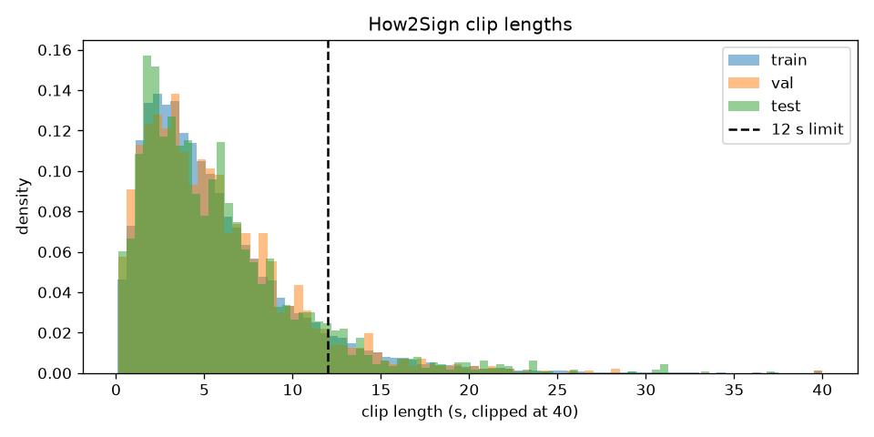

# How2Sign data inspection

Generated 2026-11-09 12:00 by `scripts/inspect_data.py` (no full extraction).

## 1. Archives

| key | file | size (GiB) | format |
|---|---|---|---|
| csv_train | how2sign_train.csv | 0.01 | csv |
| csv_val | how2sign_val.csv | 0.00 | csv |
| csv_test | how2sign_test.csv | 0.00 | csv |
| kp_val | val_2D_keypoints.tar.gz | 1.16 | tar.gz |
| kp_test | test_2D_keypoints.tar.gz | 1.58 | tar.gz |
| rgb_val | val_rgb_front_clips.zip | 1.66 | zip |
| rgb_test | test_rgb_front_clips.zip | 2.25 | zip |
| rgb_train | train_rgb_front_clips.zip | 30.76 | zip |
| kp_train | train_2D_keypoints (1).tar.gz | 21.07 | tar.gz |

## 2. English translation CSVs

- **train**: 31,165 rows, 2192 videos; columns: `VIDEO_ID, VIDEO_NAME, SENTENCE_ID, SENTENCE_NAME, START, END, SENTENCE`; all expected columns present; duplicate SENTENCE_NAME: 0
- **val**: 1,741 rows, 115 videos; columns: `VIDEO_ID, VIDEO_NAME, SENTENCE_ID, SENTENCE_NAME, START, END, SENTENCE`; all expected columns present; duplicate SENTENCE_NAME: 0
- **test**: 2,357 rows, 149 videos; columns: `VIDEO_ID, VIDEO_NAME, SENTENCE_ID, SENTENCE_NAME, START, END, SENTENCE`; all expected columns present; duplicate SENTENCE_NAME: 0

## 3. Archive layout

- **rgb_train**: 31,048 files, extensions {'.mp4': 31047, '': 1}, top folders {'raw_videos': 31048}
- **kp_train**: 5,114,724 tar members, 31,047 sentence folders, top folders {'openpose_output/json': 5052627, 'openpose_output': 31047} (scan took 259s)
- **rgb_val**: 1,739 files, extensions {'.mp4': 1739}, top folders {'raw_videos': 1739}
- **kp_val**: 278,714 tar members, 1,739 sentence folders, top folders {'openpose_output/json': 275233, 'openpose_output': 1739} (scan took 16s)
- **rgb_test**: 2,343 files, extensions {'.mp4': 2343}, top folders {'raw_videos': 2343}
- **kp_test**: 386,101 tar members, 2,343 sentence folders, top folders {'openpose_output/json': 381412, 'openpose_output': 2343} (scan took 23s)

## 4. SENTENCE_NAME <-> keypoint folder <-> RGB file

| split | CSV sentences | with keypoints | with RGB | with both | extra kp folders | extra RGB files |
|---|---|---|---|---|---|---|
| train | 31,165 | 99.6% | 99.6% | 99.6% | 0 | 0 |
| val | 1,741 | 99.9% | 99.9% | 99.9% | 0 | 0 |
| test | 2,357 | 99.4% | 99.4% | 99.4% | 0 | 0 |

## 5. fps and RGB frames vs keypoint JSON frames (20 val clips, tolerance +-2)

- fps values seen: {24.0: 18, 60.0: 2}; frame sizes: {'1280x720': 20}
- clips within +-2 frames: **20/20**

| clip | fps | RGB frames (read) | RGB frames (metadata) | JSON frames | diff |
|---|---|---|---|---|---|
| bUFsn9GQsCg_11-8-rgb_front | 24.0 | 129 | 129 | 129 | 0 |
| 204P_kHHWks_0-2-rgb_front | 24.0 | 167 | 167 | 167 | 0 |
| -f1_kdl050s_9-1-rgb_front | 24.0 | 227 | 227 | 227 | 0 |
| dIIMHOX5AD8_3-8-rgb_front | 24.0 | 137 | 137 | 137 | 0 |
| 4XlVMRXLydg_5-5-rgb_front | 24.0 | 208 | 208 | 208 | 0 |
| 4GG2H4QR9W8_9-2-rgb_front | 24.0 | 177 | 177 | 177 | 0 |
| 48Hj_AyP3Fk_12-2-rgb_front | 24.0 | 158 | 158 | 158 | 0 |
| 33YRZ5UZTA4_18-2-rgb_front | 24.0 | 15 | 15 | 15 | 0 |
| cxW8HFCWjlQ_4-8-rgb_front | 24.0 | 227 | 227 | 227 | 0 |
| 1aJwX9nRlmk_11-2-rgb_front | 60.0 | 138 | 138 | 138 | 0 |
| cDJuwtDYaSg_11-8-rgb_front | 24.0 | 13 | 13 | 13 | 0 |
| dIIMHOX5AD8_10-8-rgb_front | 24.0 | 95 | 95 | 95 | 0 |
| a4Nxq0QV_WA_1-5-rgb_front | 24.0 | 24 | 24 | 24 | 0 |
| 1G8LIWgKLME_2-2-rgb_front | 60.0 | 260 | 260 | 260 | 0 |
| afDfb8xx09w_8-3-rgb_front | 24.0 | 62 | 62 | 62 | 0 |
| ETOZLBScxWY_14-3-rgb_front | 24.0 | 251 | 251 | 251 | 0 |
| 0oGfy530AuI_12-1-rgb_front | 24.0 | 8 | 8 | 8 | 0 |
| 0oGfy530AuI_0-1-rgb_front | 24.0 | 31 | 31 | 31 | 0 |
| 1V-aOg8wCT4_13-1-rgb_front | 24.0 | 97 | 97 | 97 | 0 |
| 46Cwjrd4ua4_4-2-rgb_front | 24.0 | 39 | 39 | 39 | 0 |

## 6. Missing hands (200 sampled val clips, 29,777 frames; missing = mean hand confidence < 0.2)

- left hand missing: 22.0% of frames
- right hand missing: 23.5% of frames
- both hands missing: 8.4% of frames
- frames with no person: 0.0%; frames with more than one person: 0.0%
- clips where the right hand is missing in more than half the frames: 16/200
- keypoint counts (pose, face, left hand, right hand) seen: {'(25, 70, 21, 21)': 29777}
- unreadable JSON files: 0

## 7. Clip lengths (END - START, seconds)

| split | n | mean | median | 90th pct | max | share <= 12 s |
|---|---|---|---|---|---|---|
| train | 31,165 | 5.71 | 4.56 | 11.34 | 80.62 | 91.5% |
| val | 1,741 | 5.67 | 4.73 | 10.95 | 53.22 | 92.3% |
| test | 2,357 | 5.78 | 4.63 | 11.53 | 37.29 | 91.0% |

